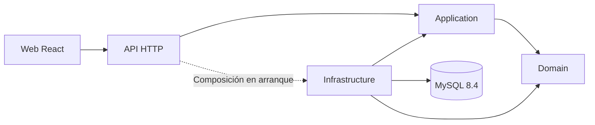

# Arquitectura de AccountingLab

La API y la web mantienen límites de arquitectura limpia. Las reglas de negocio permanecen independientes de transporte, persistencia y presentación. La política académica se encuentra en [AGENTS.md](../AGENTS.md).

| Área | Responsabilidad |
|---|---|
| Domain | Modelos, invariantes contables puras y contratos de desafíos con responsabilidad de negocio |
| Application | Casos de uso, puertos y capacidades; utiliza contratos sin construir órdenes concretas protegidas |
| Infrastructure | EF Core, MySQL, identidad y adaptadores de soporte; implementación de puertos |
| Api | Transporte HTTP, autenticación, errores y composición técnica en el arranque |
| Frontend | Presentación, flujos de interfaz y servicios HTTP; conserva importes como texto decimal |

Domain no referencia ASP.NET Core, EF Core, proveedores MySQL, Api ni Infrastructure. La referencia técnica de Api a Infrastructure se limita a la composición. La web no accede a MySQL ni reproduce la lógica contable. La autorización normal sigue funcionando mientras el desafío de reportes confidenciales está pendiente.

## Base y desafíos

La base registra asientos manuales completos, valida sus invariantes y consulta movimientos confirmados. Los contratos avanzados pertenecen a las zonas `Challenges/` y sus pruebas académicas. El catálogo y la matriz identifican su ubicación real.

La base no aplica cobros o pagos a obligaciones ni revierte comprobantes: esos resultados corresponden a DP-14. Su protección de reintentos de asientos manuales no acredita Command. El CSV simple, las agrupaciones almacenadas y los avisos iniciales tampoco acreditan contratos avanzados de exportación, jerarquía o suscripción.

Cada capacidad académica produce inicialmente un fallo explícito con su ID. La traducción HTTP a 501 se limita a ese fallo. Los errores previos de entrada o permisos conservan su causa y código. El rechazo de una capacidad pendiente no confirma documentos, movimientos, cambios de estado ni auditoría de éxito.

## Exactitud y consistencia

Los importes usan `decimal` y MySQL `DECIMAL(19,4)`. El transporte utiliza cadenas con precisión validada. Las fechas contables son explícitas y la auditoría utiliza UTC. El navegador no realiza cálculos monetarios oficiales con punto flotante binario.

Un asiento, sus líneas y su auditoría se confirman de forma atómica. Los saldos proceden de movimientos confirmados. Las operaciones repetidas conservan su resultado sin duplicar movimientos y los identificadores se limitan a su empresa. Las pruebas de estas garantías requieren MySQL real.

## Arranque y migraciones

Compose aísla el laboratorio bajo el proyecto `accountinglab-actividad3`. El orden es MySQL saludable, proceso `migrate` terminado correctamente, API disponible y web. `/health/live` distingue la vida del proceso; `/health/ready` comprueba la disponibilidad de base y esquema.

El origen del esquema es Infrastructure. Las guías de `database/` documentan su uso sin introducir otro sistema de migraciones. La base de pruebas es distinta y desechable. Los scripts no eliminan volúmenes ni datos de demostración.

## Verificaciones

Las pruebas de arquitectura detectan referencias prohibidas. Las pruebas base validan soporte y reglas manuales; las académicas esperan los contratos finales de los desafíos. El verificador de integridad comprueba asociaciones documentales y marcadores iniciales en modo docente. La revisión docente debe comprobar además que soporte, frontend y dobles no contienen soluciones equivalentes.
